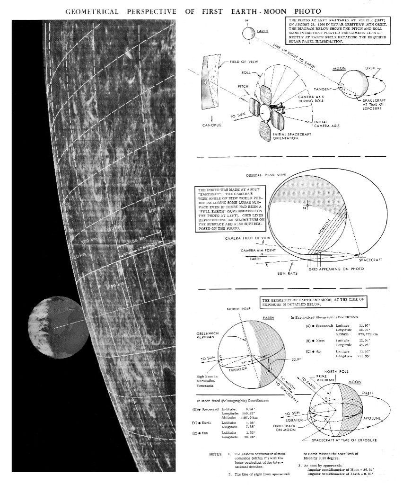

# Lunar Orbiter diagram style

A dense working guide for technical figures in the celestial-navigation explainer.

This document governs the visual and explanatory treatment of every figure on the page.
`FIGURES.md` documents the machinery around the drawing: file structure, the controls and
caption below the canvas, placement in the article, steady numbers and labels, presets, and
verification. When the two documents disagree about how a figure looks, this guide governs.

The source is the supplied NASA/Boeing-era illustration commonly titled *Geometrical
Perspective of First Earth–Moon Photo*. The point is not to imitate an old document
superficially. The point is to borrow its disciplined visual grammar: one ink, honest geometry,
semantic linework, tightly connected labels, and a high density of useful information.

> Reference image supplied for this project. The title and circa-1966 attribution follow the
> supplied description. Use it as a design reference, not as a source for navigation facts.

## 1. The governing principle

The diagram exists to make one idea easier to understand.

Style is subordinate to explanation. A figure should not look technical merely to create an
impression of authority. It should expose a relationship that prose alone would make harder to
see: a direction, an angle, a shared axis, a conversion, a crossing, a sign, a sequence, or a
cause and effect.

Before drawing, write one sentence:

> After looking at this figure, the reader should understand that ______.

Every visible mark must help complete that sentence. If a title, border, number, axis, table,
rule, hatch, or label does not help, remove it.

The style is therefore best described as **explanatory engineering drawing**, not archival
decoration.

## 2. What to borrow from the reference

The reference succeeds through a small set of repeated decisions:

- A tall photographic observation and several clean schematics form one coherent argument.
- Physical bodies are visually heavier than rays, axes, leaders, and dimensions.
- Hidden geometry remains visible through meaningful dash patterns.
- Wireframe spheres explain orientation without shaded rendering.
- Explanatory prose sits beside the exact geometry it interprets.
- Labels are connected to their subjects rather than left floating.
- Numeric values are associated with named points in the drawing.
- Dashed horizontal rules separate real stages of the argument.
- Whitespace keeps a dense page legible.
- The drawing is schematic in distance but careful about angle, side, direction, and tangency.

Borrow those relationships. Do not borrow accidental qualities of the scan, tiny print, fake
document codes, bureaucratic language, or density that does not help the lesson.

## 3. One ink, one ground

The canvas is strictly monochrome.

- Light theme: crisp white ground and near-black ink.
- Dark theme: crisp dark ground and near-white ink.
- Read both dynamically from `PLATE.paper` and `PLATE.ink`.
- Do not hard-code aged cream, warm paper, or a faux scanned background.
- Do not use semantic accent colors inside a figure.
- Do not create gray hierarchy with translucent fills or arbitrary opacity.
- Use line weight, spacing, pattern, hatching, and open versus filled marks instead.

Antialiasing naturally creates edge pixels between ink and ground; that is not an additional
color. Deliberate gray fills, faded labels, translucent regions, gradients, glows, and shadows
are not part of the system.

The figure frame below the canvas (sliders, buttons, readouts, caption) is monochrome too and
uses the same face, so the figure reads as one object. A readout that needs emphasis is
set bold, not colored. See `FIGURES.md` §3.

## 4. Line pattern carries meaning

Dash patterns are vocabulary. Use them consistently and sparingly.

### Solid

Use solid lines for:

- visible physical edges;
- planet and instrument outlines;
- a measured or final plotted result;
- a local horizon when it is an actual reference in the measurement;
- box borders;
- dimension ticks;
- leaders.

### Long dash: `8 5`

Use long dashes for real but unseen geometry:

- a line of sight;
- a light path when the ray itself is conceptual rather than a visible object;
- an orbit;
- a projected direction;
- a hidden portion of a great circle;
- an extension beyond a visible object.

### Short dash: `3 3`

Use short dashes for secondary guides:

- chart grids;
- pending or provisional geometry;
- low-priority alignment guides;
- a preview that has not yet become the result.

Do not use short dashes simply because a second data series needs to look different. Prefer a
direct label and spatial separation.

### Dash-dot: `8 3 1.5 3`

Use dash-dot construction lines for:

- axes;
- centerlines;
- symmetry;
- collinearity;
- a local vertical or reference normal when its role is geometric.

A reader should be able to distinguish matter, an unseen physical relationship, and a
construction reference before reading the labels. If the pattern cannot be explained in one of
those terms, use a solid line or remove it.

## 5. Three line weights at most

Use a shallow hierarchy:

1. **Primary, 1.5–2 px:** Earth limbs, instrument frames, the central plotted curve, the one
   result the reader must notice.
2. **Secondary, 0.8–1.1 px:** rays, horizons, orbits, meridians, angle arcs, and important
   relationships.
3. **Fine, 0.45–0.7 px:** leaders, hatching, ticks, grids, and construction lines.

Do not add weight levels to encode more categories. Direct labels are clearer. The heaviest
line should identify the physical subject or the figure's conclusion, not a decorative frame.

Keep weights stable in CSS-pixel drawing coordinates after device-pixel-ratio scaling.

## 6. Spheres are geometric, not rendered

A sphere begins with a strong limb circle. Add only the geometry needed for the claim:

- an equator ellipse;
- one or two meridians;
- a polar axis extending just beyond the limb;
- a center crosshair;
- named surface points;
- a terminator if illumination matters.

Near-side great-circle segments are solid. Far-side segments are long-dashed. A point on the
far side may be open or dashed, but its treatment must be explained by position, not by a
line-style legend.

Do not add a full graticule merely to make the sphere look scientific. A plain section circle is
often clearer than a globe. Use a globe only when longitude, latitude, far-side geometry, or
orientation in three dimensions matters.

## 7. Shade structurally

When a light and dark side matters, construct the dark side as a lune bounded by the limb and
terminator.

- Clip parallel hatch lines to the exact region.
- Use one consistent hatch angle and spacing.
- Reserve cross-hatching for a genuinely distinct, darker category.
- Keep the boundary readable independently of the hatch.
- Never substitute a gray or translucent wash.

Hatching is information. If illumination is irrelevant, omit it.

## 8. Geometry comes before layout

Compute the physical or mathematical model in world, angular, or normalized instrument space.
Project that model into the responsive canvas afterward.

The result of a physical test must never depend on viewport size. Examples:

- whether a reflected ray reaches the horizon mirror;
- whether two circles intersect;
- whether a point is on the near or far side of a globe;
- whether a line is tangent;
- which way an intercept moves;
- whether a body is north or south at meridian passage.

Responsive layout may change spacing, scale, label position, or the amount of secondary detail.
It must not change the underlying answer.

## 9. Schematic distance, honest relationships

Not every distance can be to scale. Earth and Moon, a star and Earth, or a sextant's optical
path may need schematic compression. That is acceptable.

The following must remain honest:

- angle magnitude and sign;
- clockwise versus counterclockwise direction;
- north, south, east, and west;
- which side of an axis a point occupies;
- parallelism;
- perpendicularity;
- tangency;
- incidence and reflection;
- near side versus far side;
- toward versus away;
- apparent versus true direction;
- geometric versus refracted horizon;
- the sequence in which a ray meets surfaces.

When an offset is exaggerated, label the exaggeration or state the true value nearby. Never let
a precise number imply that an obviously schematic length is to scale.

## 10. Labels are part of the geometry

No important element should float unexplained. Prefer, in order:

1. a label placed at the clear end of its own line;
2. a label beside an isolated point;
3. a leader from whitespace to the feature;
4. a compact inset when the local geometry is too crowded.

Leaders are thin solid lines, usually straight or with one elbow. Their small solid arrowhead
touches the feature without covering it. Text stays horizontal. A leader may cross a line when
necessary; text may not.

Use `createPlateLabeler` for interactive or crowded figures:

- reserve physical objects and high-value geometry first;
- provide several meaningful candidate positions;
- place high-priority labels before optional ones;
- move labels outward before reducing size;
- use a paper knockout only when needed for legibility;
- never let a knockout erase a planet limb, ray junction, angle, or intersection;
- use `fallback: 'hide'` for genuinely optional labels;
- do not hide the one label that explains the figure's conclusion;
- order candidates by preference and keep the list stable across states. The labeler holds a
  label on its previous seat while that seat stays clear, so a label moves only when it must,
  and then in one step (`FIGURES.md` §4).

When a region becomes crowded, the preferred response is:

1. shorten the wording;
2. move the label outside the geometry;
3. lengthen its leader;
4. suppress a lower-priority label;
5. create a magnified inset;
6. only then reduce type slightly.

## 11. Typography must survive the device

Inside the diagram:

- Use one geometric face for everything in the figure, labels and numbers alike, as the
  period plates set everything in Futura. The project bundles Jost (a free Futura revival,
  `assets/fonts`, SIL OFL), so every device draws the same plate. Avenir Next Condensed and
  Helvetica are only fallbacks. Real Futura is commercial; do not swap in an unlicensed copy.
- Jost is wider than a condensed face. Size boxes, table columns, and label lanes from measured
  text, never from hard-coded widths, so a font change cannot overflow them.
- Use uppercase, modest tracking, and regular weight for short diagram labels. Weight 600 is
  for the figure's title line and the one label that carries its conclusion, not for emphasis
  elsewhere.
- Control labels below the canvas are plate caps too; captions are sentence case.
- Prefer underlining, boxing, or size over bold.

Use exactly two canvas text paths:

- `plateText` for short tracked labels, headings, and box titles. Its default uppercase is part
  of the plate's voice.
- `plateDataText` for values, coordinates, times, units, equations, and conventional notation.
  It sets the same face without tracking and preserves case, so `Ho`, `Hc`, `Zn`, and `nm`
  remain distinct and readable.

Do not use the generic `label()` path inside a figure renderer. Do not simulate data text
with `plateText`; that still uppercases and tracks notation unless explicitly overridden.

Both helpers draw digits on a fixed advance (the width of `0`), so live numbers keep their
width. Keep text that contains a changing number in these helpers.

Sizes are nominal. Every plate text helper (and the labeler's collision boxes) multiplies the
size it is given by `PLATE_TEXT_SCALE` (1.22), so a demo passing `size: 9` renders at about
11 px. Write sizes in nominal units; adjust the one constant if all figure text needs to grow
or shrink. Code that lays out lines by hand must multiply by `PLATE_TEXT_SCALE` too (see
`demos/almanac.js`). Practical minimums, nominal (rendered in parentheses):

- Essential desktop canvas text: 9 (11 px) or larger.
- Secondary desktop annotation: 8 (9.8 px) or larger.
- Essential mobile canvas text: 8 (9.8 px) or larger.
- Secondary mobile annotation: 7.5 (9.2 px) or larger.
- A very short, direct chart label may reach 6.8 (8.3 px) only when it is secondary and no
  longer wording can replace it.

Never shrink a paragraph, formula, instruction, or critical value to make a dense layout fit.
Shorten, reflow, stack, or remove material instead.

The period reference uses very small text because it is a large printed plate. A 283 px mobile
canvas does not have that luxury.

## 12. Write like a teacher, not an engineer impersonator

The visual style may be technical; the voice should be plain.

- Start with what the reader can see or do.
- Define a real navigation term before relying on its abbreviation.
- Prefer verbs: "move," "turn," "subtract," "cross," "look up," "draw."
- Use the actual name of a thing, not systems language.
- State cause before formula.
- Keep one label to one job.
- Explain why a number matters.

Good:

- "Earth turns east, so Vega's GP moves west."
- "Move 3 nautical miles toward the GP, then draw the LOP at 90°."
- "Air makes the star look higher."
- "Two circles cross twice; a third chooses the fix."

Avoid:

- "direction-transfer register";
- "four-axis acquisition";
- "keyed operational reduction";
- "apparent-to-true transfer";
- "inspection offset active";
- "constraint distribution plate."

Use real specialist terms when they are the lesson: geographical position, zenith distance,
declination, refraction, intercept, GHA, SHA, LHA, AP, Zn, and LOP. Define them in plain words.
Do not replace precision with vagueness; remove only jargon that performs no explanatory work.

## 13. Explanatory boxes are earned

A box may explain one inference that cannot be labeled locally. It is not automatic decoration.

- One idea per box.
- One hairline rectangular border.
- No fill other than the canvas ground.
- No rounded corners, shadows, double rules, tabs, badges, or icons.
- Use a short title and two to four short lines.
- Put the box adjacent to the geometry it interprets.
- Keep the source/ray/interaction corridor clear.

Use one shared internal rhythm:

- a 0.8 px rectangular border;
- at least 7 px padding on desktop and 6 px on compact canvases;
- a short tracked title in the label face;
- one hairline rule below the title;
- two to four lines set to the normal type floors;
- data-face text only for actual symbols, values, or equations.

If the same words already appear in the caption or controls, remove the box.

## 14. Data must connect to a mark

Show numeric data only when it helps the reader understand the geometry or perform the next
step.

A table is justified when:

- several points need exact values;
- rows correspond directly to labeled points;
- aligned precision makes comparison easier;
- the values change together during interaction.

Tie rows to the drawing with names or meaningful keys. Do not invent `(A)`, `(B)`, plate codes,
or catalog numbers solely to look archival. A key is useful only if the same key visibly joins
the table and geometry.

Keep units attached to values. Keep sign conventions explicit. Distinguish:

- a signed correction from its positive magnitude;
- observed altitude from predicted altitude;
- a current sample from a saved peak;
- candidate spacing from third-sight miss distance;
- a geometric range from a conventional refracted range.

Pending stages show placeholders, not future answers.

## 15. Composite plates need a real sequence

A vertical or horizontal stack of sub-diagrams is appropriate when the reader must follow a
sequence such as:

1. situation;
2. mechanism;
3. detailed geometry;
4. arithmetic or conclusion.

Use long dashed rules only to separate those real beats. Do not split a simple idea into panels
to imitate the reference. Do not add `PLATE 05-B`, a fake year, a fake drawing number, a revision
stamp, or other archival chrome.

One plate is one narrative. If a single direct diagram teaches it better, use the single
diagram.

## 16. Reuse the clearest model

A plate does not need a novel camera, mechanism, or metaphor.

If an earlier treatment (see the `sextant-figure-variants-archive` branch) already has the best
explanatory geometry:

- preserve that geometry;
- restyle it with the monochrome line system;
- simplify its labels;
- remove color-dependent meaning;
- retain only useful live values.

Novelty is not a goal. Clarity is the goal. A plate may be the same conceptual model expressed
with a stricter drawing language.

## 17. Arrows show direction

Use one small solid triangular arrowhead throughout.

- A vector has one arrowhead at its destination.
- Motion uses an arrowhead placed directly on the path.
- Light follows its actual direction of travel.
- A leader's arrowhead identifies a feature; it does not imply motion.
- A measured span may use two opposing dimension arrowheads.
- Do not add arrows to straight lines as decoration.
- Do not let arrow length change with state unless length itself encodes magnitude.

Labels such as `TO VEGA`, `TOWARD GP`, `N`, or `TO TELESCOPE` should clarify the direction when
the geometry alone is ambiguous.

## 18. Dimensions use standard construction

A measured span consists of:

- extension ticks at the endpoints;
- a fine dimension line;
- inward-facing arrowheads;
- one value with units;
- enough whitespace that the value does not sit on other linework.

Angles use a small arc between the actual rays. A right angle uses a square mark. If an angle
arc becomes too small to carry arrowheads honestly, simplify it to a bare arc or move the value
to a leader. Never flip arrows outside an angle in a way that makes the shown angle look larger.

## 19. Parallel rays must look parallel

A star is effectively at infinity. Rays from it reaching different points on Earth are
parallel.

- Draw them with the same direction.
- Use matching parallel slash marks when the relationship needs emphasis.
- Do not connect the marks with a horizontal label line that can be mistaken for a horizon.
- Do not place a star glyph where only one of several supposedly parallel rays points at it.
- A local horizon is tangent to Earth at the observer and perpendicular to the local vertical.
- Keep the horizon local unless extending it serves a specific proof.

These lines are often the entire argument. Extra axes, leaders, or labels must not cross their
critical angle or point of contact.

## 20. Instruments must remain recognizable

Optical diagrams still need the physical object that creates the optics.

- Draw instrument members as joined, closed forms rather than floating strokes.
- Show pivots, mirrors, the moving arm, engraved arc, and telescope when they explain the path.
- Keep the ray path visually dominant.
- Separate a face view from an edge view when a half-silvered mirror cannot be understood in one
  projection.
- Compute reflection in normalized instrument space.
- Use the responsive layout only as a projection of that solution.
- When a ray misses, say so and do not report a nonexistent second reflection or image.

The diagram should answer both "what does the light do?" and "what part of the sextant does it?"

## 21. Interaction changes evidence, not truth

Interaction should reveal a relationship, not create visual activity for its own sake.

- A slider changes a quantity the reader can name.
- A drag target says that it can be dragged.
- A reveal control withholds only information the reader is being asked to consider.
- A reset restores a deterministic, explained state.
- The initial state is meaningful and never blank.
- Impossible actions are disabled.
- A hidden third sight cannot already label a candidate "rejected."
- A current sample cannot be relabeled as a previously saved result.
- Shared time changes update every figure that claims to show that time.

Status copy is part of state truth. It must describe the current state, not the last convenient
state.

## 22. Drawing should be a pure read of state

The draw callback may run repeatedly while visible. It should paint from current state without
changing layout or application state.

Do not:

- change control text every frame;
- write status DOM inside the draw loop;
- resize the panel while drawing;
- advance an animation by frame count;
- emit shared-state changes while rendering;
- ease or glide labels between positions. A label is drawn where it belongs in the current
  state; the labeler's seat memory is the only frame-to-frame continuity.

Those patterns can create feedback between rendering, control height, `ResizeObserver`, and
canvas size, producing flashing or blank frames.

Instead:

- update state in input handlers, timers based on elapsed time, or explicit actions;
- synchronize controls once when state changes;
- calculate all dependent values before replacing shared state;
- let `draw(ctx, w, h)` be deterministic for the same state and dimensions.

## 23. Responsive design is selective editing

Do not scale a desktop plate uniformly down to mobile.

At compact widths:

- preserve the central geometry;
- shorten direct labels;
- stack values;
- replace a multi-column table with two readable lines per row;
- show the worked example before secondary examples;
- remove repeated legends;
- move labels outside crowded circles;
- hide optional notes;
- reserve more vertical space when controls wrap.

Canvas height is part of the composition. A short ruler, six-row sequence, or decoded result
must not float in the middle of a canvas sized for a globe or a full curve. Give a figure its
own `aspect`, `maxH`, `compactAspect`, and `compactMaxH` when its argument needs a different
shape. If an interaction changes a tall search view into a short decoded view, update those
values and call `d.refit()`.

For a geometry-plus-explanation plate, a useful desktop starting point is 60–75% of the body
for the primary geometry and 25–40% for the box or data card. On compact canvases, stack those
regions. These are not quotas: the test is whether every large blank region protects motion,
labels, or comprehension. Do not center a compressed composition between equal empty bands.

The compact version may contain less information, but it must make the same claim and preserve
the same mathematical result.

Test the actual 283 px canvas produced by a 320 px viewport, not only an abstract 320 px artboard.

## 24. Dark mode is a true inversion

Every figure must work on both grounds.

- Paint the full canvas with `PLATE.paper`.
- Draw every plate mark with `PLATE.ink`.
- Do not cache theme colors at module initialization.
- Avoid image-like gray fills that fail when inverted.
- Make hatch spacing and weight legible in both directions.
- Verify paper knockouts use the live ground.

The result should read as ink on white in light mode and white drafting on dark in dark mode.

## 25. Project primitives

The shared implementation lives in `app.js`.

- `PLATE.ink`, `PLATE.paper`: live theme colors.
- `PLATE.font`, `PLATE.dataFont`: label and numeric faces.
- `plateTextWidth`: tracked uppercase measurement.
- `plateText`: tracked uppercase labels.
- `plateDataText`: case-preserving, untracked values and conventional notation.
- `plateDash`: shared semantic patterns.
- `plateLine`: monochrome line with semantic pattern and weight.
- `plateArrowhead`: standard filled triangular head.
- `plateVector`: directed line.
- `plateLeader`: elbow leader to a target.
- `createPlateLabeler`: collision-aware candidates and reserved zones.
- `plateBox`: one explanatory box.
- `plateRule`: long dashed section separator.
- `plateHatch`: clipped structural shading.
- `plateWireSphere`: limb, near/far graticule, axis, and center.
- `plateDimension`: measured span with ticks, heads, and value.
- `angleDim`: an angle arc that shrinks its heads with the arc and never draws outside it.
- `rightAngleMark`, `pointMark`, `starGlyph`: the square corner, a point, a star.
- `fmtDM`: degrees and minutes at a fixed number of decimals.
- `globeView`, `drawGlobeBase`: the orthographic globe with coastlines.
- `deckGaugeLayout`: the graduated 0–90° deck gauge.

`label`, `leaderNote`, `centerline`, and `dimHead` remain in `app.js` from the color era. Do
not use them in new figures.

Prefer these primitives to local approximations. Add a shared primitive only when at least two
figures need the same visual meaning.

## 26. Recommended construction order

Build a figure in this order:

1. State the one-sentence claim.
2. Identify the minimum physical and geometric entities.
3. Solve the geometry independently of the viewport.
4. Choose the clearest existing explanatory model.
5. Establish the primary object and result.
6. Add only the axes, rays, horizons, or circles needed to prove the claim.
7. Reserve those important regions for label placement.
8. Place direct labels and leaders.
9. Add one useful equation or data group.
10. Add interaction only if it exposes the relationship.
11. Design the compact layout explicitly.
12. Apply the monochrome line grammar.
13. Remove one unnecessary element.
14. Test truth, collisions, themes, and state transitions.

Visual styling comes after the model and hierarchy, not before them.

## 27. Verification matrix

Before calling a figure complete, verify:

### Geometry

- Default state.
- Every slider minimum and maximum.
- Aligned, zero, tangent, overhead, and near-coincident states.
- Both signs where a quantity may be positive or negative.
- Near-side and far-side globe cases.
- Hidden and revealed stages.
- Same physical answer at desktop and mobile sizes.

### Layout

- Desktop light.
- Desktop dark.
- 390 px light and dark.
- 320 px light and dark.
- Wrapped controls.
- No horizontal panel or document overflow.
- No label-label, label-line, or label-control collision.
- No essential text below the stated minimums.
- No large empty band unless it protects an interaction envelope, label lane, or real stage of
  the argument.

### Rendering

- Canvas always paints a nontransparent ground.
- No colored canvas pixels beyond antialiasing noise.
- Stable dimensions and pixel hash after state settles.
- Slider sweeps step by step without labels hopping between seats or numbers changing their
  decimal count.
- No draw-time DOM mutation.
- No page or console errors.
- Reduced-motion mode remains usable.

### Copy and state

- Every abbreviation is already known or defined.
- Captions remain true at control extremes.
- Current, pending, saved, and revealed values are distinct.
- Units and signs are correct.
- No fake plate number, fake year, or decorative metadata.
- No phrase exists only to sound technical.

## 28. Rejection checklist

Reject or revise a plate if any answer is yes:

- Would the figure be equally clear after deleting its main box?
- Is a line present only because the reference image had many lines?
- Does a dash pattern lack a stable meaning?
- Does a label describe the rendering method instead of the idea?
- Is type small because too much information was retained?
- Does a paper knockout erase important geometry?
- Does the answer change with canvas dimensions?
- Does a status value describe a previous interaction?
- Is a table repeating the controls?
- Is a key or number decorative?
- Does the title sound like invented engineering jargon?
- Could a novice state the point after looking for five seconds?

If the last answer is no, return to the one-sentence claim.

## 29. Non-negotiable exclusions

Never add:

- color inside a figure;
- gradients, glows, blurs, or shadows;
- flat gray fills or translucent shading;
- rounded boxes, pills, badges, icons, or emoji;
- fake drawing numbers, years, revision stamps, or "plate" labels;
- decorative keys and tables;
- arbitrary dashes;
- unexplained variables;
- tiny paragraphs;
- overlapping text;
- viewport-dependent physics;
- ambient animation that competes with the explanation;
- technical-sounding language without technical necessity.

## 30. Final standard

The reference should be visible in the discipline of the result, not in decorative imitation.

A successful figure feels:

- exact but approachable;
- dense where the idea is dense;
- sparse where the idea is simple;
- unmistakably monochrome;
- mechanically coherent;
- calm under interaction;
- legible on a phone;
- truthful at every state;
- and easier to understand than the paragraph it accompanies.
